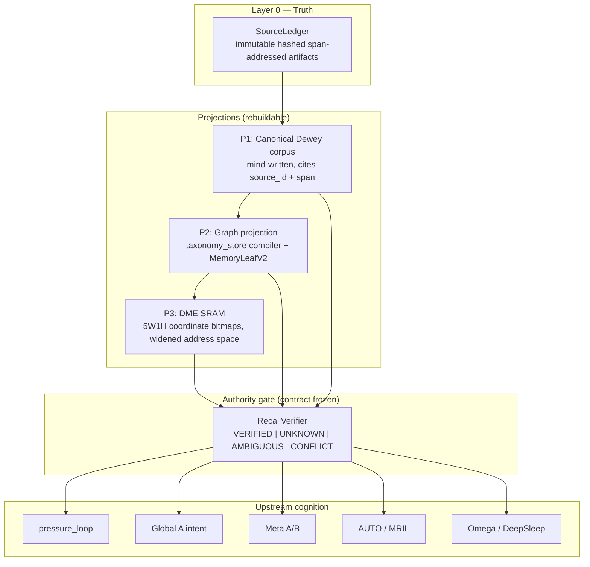
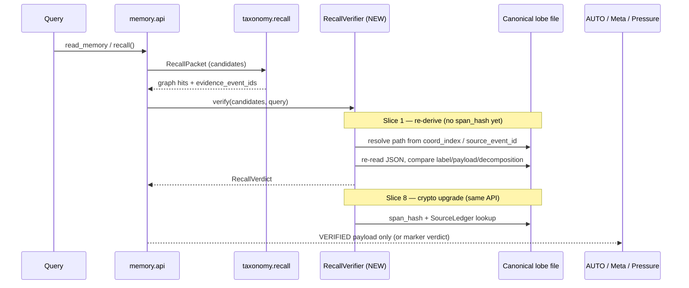
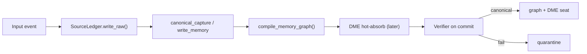

# Omega Memory Engine v2 — Integration Map (Approach B, Gate-First)

> **Authority:** Maps the v2 spec in `F:\Omega Memory Engine v2.txt` onto live Omega 3.0 on disk.
> **Approach:** B — Gate-first. Build `RecallVerifier` over the existing recall stack first; slide
> SourceLedger, DME, and SenseRegistry underneath an already-live gate. The gate contract never
> changes; its evidence gets stronger as each layer lands.

---

## Architecture lock (three decisions)

| Decision | Meaning | Live anchor |
|----------|---------|-------------|
| **Ledger beneath corpus** | Immutable source artifacts sit *under* the living Dewey tree; corpus records are projections that *cite* sources, not truth themselves | Today the Dewey tree (`memory/000_identity/…1100_dev/`) *is* de-facto truth; no separate `SourceLedger` yet |
| **One graph projection, extended** | Single disposable compiler → `graph.sqlite`; extend schema with `MemoryLeafV2` provenance fields, don't add a second graph | `memory/taxonomy/compiler.py` (v5) already does full rebuild from canonical |
| **5W1H geometry + Dewey on sense layer** | Coordinates stay Dewey `(X,Y,Z)`; polysemy resolved via `SenseRegistry` *before* commit/recall; DME is a coordinate accelerator, not authority | `memory/dewey_map.py` + lobe-4 `SITUATIONAL_FACETS`; `memory/enrichment/situational.py` is the deterministic 5W1H decomposer seed |

**Product phrase (unchanged):** DME finds → Graph relates → Filesystem proves → Omega acts.

---

## Target stack (locked)

```
SourceLedger (immutable truth: hashed, span-addressed artifacts)
  → Canonical Dewey corpus   (projection 1 — living, mind-written, cites sources)
  → Graph projection          (projection 2 — taxonomy_store compiler, +MemoryLeafV2 fields)
  → DME SRAM                  (projection 3 — 5W1H coordinate bitmaps, widened address space)
  → RecallVerifier            (four-verdict gate: VERIFIED / UNKNOWN / AMBIGUOUS / CONFLICT)
  → Upstream cognition        (verdicts as pressure deltas; auto never acts unverified)
```



**Hard rule (INV-MEM-007):** AUTO never acts on unverified recalled memory. Meta may inspect
AMBIGUOUS/CONFLICT. Omega/DeepSleep may reconcile.

---

## As-built today → v2 layer map

### Layer 0 — SourceLedger

| v2 module | Status | Live equivalent | Gap |
|-----------|--------|-------------------|-----|
| `SourceArtifact` + immutable store | **Exists** | `memory/source_ledger/store.py` | Gate + promotion + `build_memory_dict` stamp provenance |
| Span offsets + `source_type` | **Exists** | `SourceArtifact.span_*`, `citation()` | Wired on canonical writes |

### P1 — Canonical Dewey corpus

| v2 role | Status | Live modules | Notes |
|---------|--------|--------------|-------|
| Living mind-written corpus | **Exists** | `memory/api.py` (`write_memory`, `CanonicalEnvelope`), `memory/dewey_map.py`, lobe dirs, `memory/indexes/coord_index.json` | Direct writes for cognitive self-writes (`bypass_guardian=True`) per `AGENTS.md` |
| Episode → canonical capture | **Exists** | `memory/taxonomy/canonical_capture.py`, `pressure_loop/temporal_store.py` | Routes to lobes 4 (5W1H situational) and 9 (temporal) |
| Cites sources | **Done** | `provenance.source_id` via `ensure_source_citation()` on gate writes + promotion staging + episode capture via `write_memory` |

### P2 — Graph projection (extended)

| v2 role | Status | Live modules | Notes |
|---------|--------|--------------|-------|
| Disposable compiled graph | **Exists** | `memory/taxonomy/compiler.py`, `graph_store.py`, `paths.py` → `memory/taxonomy_store/compiled/graph.sqlite` | Deterministic rebuild; `compile_trigger.py` on episode close |
| Recall over graph | **Exists** | `memory/taxonomy/recall.py` → `RecallPacket` | Scored lexical/entity/graph-proximity; no verifier |
| `MemoryLeafV2` fields | **Exists** | `memory/taxonomy/schemas.py` + `compiler._memory_leaf_from_meta()` | Quarantined leaves filtered at recall |
| Meta skill recall | **Exists** | `memory/taxonomy/meta_recall.py` | Skips quarantined/rejected/superseded graph payloads |

### P3 — DME SRAM

| v2 role | Status | Live modules | Notes |
|---------|--------|--------------|-------|
| 4096-bit coordinate bitmap recall | **Live** | `memory/dme/adapter.py` | Merged into `read_memory` / `recall_verified` before verifier gate |
| 5W1H decomposer (write=read spine) | **Partial** | `memory/enrichment/situational.py`, `dewey_map.SITUATIONAL_FACETS`, `canonical_capture.EVENT_KIND_TO_FACET` | Same geometry idea; not bitmap SRAM |
| Hot absorb / seating | **Live** | `compile_memory_graph()` → `rebuild_sram_from_graph()` (hard fail on error) | `load_sram()` self-heals stale snapshot_hash |

### Gate — RecallVerifier

| v2 role | Status | Live modules | Notes |
|---------|--------|--------------|-------|
| Four-verdict gate | **Exists** | `memory/recall_verifier.py`, `RecallVerdict` in schemas | Re-derive + optional source-ledger proof |
| Re-derive verification (slice 1) | **Live** | Graph hit → coord_index → lobe file re-read | `verify_leaf()` exported |
| Crypto span proof (later) | **Live** | `_verify_source_proof()` span_hash crypto path | Cited records use `source_ledger_crypto`; re-derive for uncited only |

### Upstream cognition

| Consumer | Today's recall entry | Verdict-aware target |
|----------|---------------------|----------------------|
| **AUTO / MRIL** | `auto_loop/mril_tools/remember.py` → `recall_verified` | Only `VERIFIED` payloads; fail-closed on bad injectors |
| **Fast reply** | `pressure_loop/fast_reply.py` → `recall_verified` | Same gate |
| **Meta A skill pick** | `memory/taxonomy/meta_recall.py` | Skips quarantined graph payloads |
| **Global A** | No direct recall yet | Verdict pressure via `recall_verdict_pressure_contributor` |
| **Pressure** | `analyze_recall_verdict_pressure()` + always-on contributor | `memory_gap` / `sense_resolution` / `memory_reconciliation` |
| **Omega** | `omega_loop/episode/` consumes gated recall via `read_memory` | Fail-hard on recall-poison |

---

## Approach B — integration seams (gate first)

The gate's **public contract never changes**. Evidence strengthens as layers land underneath.



### Seam 1 — Primary API surface

**File:** `memory/api.py`

| Phase | Change |
|-------|--------|
| **B1 (now)** | Add `recall_verified(query) -> RecallVerdict` alongside `read_memory`; internally calls existing `taxrecall.recall` + new verifier |
| **B2** | `read_memory` becomes adapter: returns `RetrievalResult` **only** when verdict=`verified`; otherwise empty candidates + verdict in `meta` |
| **Never** | Let `taxrecall.recall` results reach AUTO/MRIL without passing through verifier |

### Seam 2 — Verifier module (new)

**Proposed path:** `memory/recall_verifier.py`

```python
# Contract frozen from day 1
@dataclass
class RecallVerdict:
    status: Literal["verified", "unknown", "ambiguous", "conflict"]
    query: str
    answer_payload: dict | None
    evidence: list[dict]
    rejected_hits: list[dict]
    reason: str
```

**Slice 1 re-derive algorithm (maps to existing files):**

1. Input: `RecallPacket.results[]` from `memory/taxonomy/recall.py`
2. For each hit: follow `evidence_event_ids` → `read_events_from_canonical()` (`memory/taxonomy/canonical_events.py`)
3. Resolve Dewey file: `coord_index.json` entry → read JSON from disk
4. **Verify:** graph `label` + `payload` still consistent with file `title`/`summary`/`text`/`enrichment`
5. **Conflict:** two canonical files disagree on same subject (reuse `memory/supersedes.py` + claim `CONTRADICTS` edges)
6. **Ambiguous:** single-token entity without resolved sense (stub → full `SenseRegistry` in slice 5)
7. Emit verdict; stash `rejected_hits` for Meta/Omega audit

### Seam 3 — AUTO hard block

**Files:** `auto_loop/mril_tools/remember.py`, `auto_loop/execute/run.py`

| Rule | Wiring |
|------|--------|
| `memory_recall_required(pack)` + verdict ≠ verified | Fail-hard or empty grounding (no fake continuity) |
| `_recall_has_evidence(rk)` | Rename conceptually to `_recall_verified(rk)` — evidence count alone is insufficient |
| Question/reasoning grounding blocks | Only attach when `verdict.status == "verified"` |

### Seam 4 — Pressure deltas

**Files:** `pressure_loop/taxonomy_pressure.py`, `memory/taxonomy/pressure_signals.py`, `global_loop/intent/run.py`

| Verdict | Pressure kind (new) | Existing hook |
|---------|---------------------|---------------|
| `unknown` | `memory_gap` / learning query | Extend 7M advisory signals |
| `ambiguous` | `sense_resolution` | New contributor |
| `conflict` | `memory_reconciliation` | Tie to `resolve_contradiction` + quarantine |
| `verified` | (none — normal flow) | — |

Flag: keep `OMEGA_MEMORY_TAXONOMY_PRESSURE` off for manufactured failure pressure; verdict-driven
pressure is mind-aligned.

### Seam 5 — Write path (after gate is live)



**Live write hooks today:**

| Step | Module |
|------|--------|
| Operator / episode input | `memory/gates/*`, `pressure_loop/temporal_store.py` |
| Close capture | `cognition_chain._capture_episode_to_taxonomy` → `canonical_capture.capture_episode_to_canonical` |
| Graph rebuild | `memory/taxonomy/compile_trigger.request_compile_on_close` → `reindex_and_compile` |

**v2 insertion point:** between capture and compile — ledger write first, then canonical cite, then compile.

---

## Slice plan (Approach B reordered for live repo)

| Slice | v2 spec | Approach B priority | Touch list | Acceptance |
|-------|---------|---------------------|------------|------------|
| **0** | Baseline resurrection | — | Existing `tests/memory/*`, `tests/memory/taxonomy/*` | Green suite |
| **1** | RecallVerifier (re-derive) | **FIRST** | `memory/recall_verifier.py`, `memory/taxonomy/schemas.py` (`RecallVerdict`), tests | Graph hit → lobe file match → four verdicts |
| **2** | Omega gate | **SECOND** | `memory/api.py`, `auto_loop/mril_tools/remember.py`, `auto_loop/execute/run.py`, `pressure_loop/fast_reply.py` | `unverified_upstream_admissions: 0` |
| **3** | Pressure integration | **SECOND** | `pressure_signals.py`, `taxonomy_pressure.py`, `global_loop/intent/run.py` | Verdicts → pressure deltas |
| **4** | SourceLedger | Third | `memory/source_ledger/`, `core/paths.py` | Immutable artifacts + sha256 |
| **5** | File-backed MemoryLeafV2 | Fourth | `schemas.py`, `compiler.py`, `graph_store.py` | `source_id`, spans, `status` on nodes |
| **6** | GraphCompiler spans | Fourth | `compiler.py`, `extract.py` | Deterministic rebuild from ledger |
| **7** | SenseRegistry | Fifth | `memory/sense_registry.py`, hook in `gates/base.py` + `recall_verifier` | Polysemy tests: neuron, node, model, agent, graph |
| **8** | ThoughtEngineAdapter / DME | Sixth | New `memory/dme/` (resurrect ThoughtEngine) | SRAM seats canonical leaves only; parity check |
| **9** | Verifier crypto upgrade | Seventh | `recall_verifier.py`, `hashing.py` | span_hash proof replaces re-derive |
| **10** | Integrity daemon | Eighth | `memory/integrity/` or extend `memory_health()` | orphan/source/sense/DME parity audits |

**Slices 9–10 as-built:** Cited canonical records verify via `source_ledger_crypto` (`span_hash_for` + ledger lookup) without graph text re-derive. `memory/integrity/audit.run_integrity_audit()` reports orphan graph leaves, missing source artifacts, hash mismatches, and DME parity drift; `memory_health()` surfaces audit issues.

**Post–slice-10 follow-ups (complete):** `pressure_loop/integrity_pressure.py` runs cached integrity audits on pressure ticks (`OMEGA_MEMORY_INTEGRITY_PRESSURE`, `OMEGA_MEMORY_INTEGRITY_AUDIT_INTERVAL`). Sense-registry orphan rows are audited in `_sense_registry_audit()`. Operator ingress stamps `source_citation` via `publish_operator_ingress()` + `record_operator_chat_source()`; episode capture preserves that citation into situational writes instead of re-recording synthetic event text.

**Poisoning protection ships in slice 1–2.** DME arrives as recall accelerator under an already-trusted gate.

---

## Data layout (target, one store tree)

```
memory/
├── source_ledger/          # NEW L0 — immutable artifacts (Slice 4)
│   └── artifacts/{source_id}.json
├── 000_identity/ … 1100_dev/   # P1 — canonical Dewey corpus (exists)
├── indexes/coord_index.json    # P1 index (exists)
├── taxonomy_store/             # P2 — compiled projection (exists)
│   └── compiled/graph.sqlite
├── dme/                        # P3 — SRAM bitmaps (NEW)
│   └── sram.bin
├── sense_registry/             # Sense layer (NEW)
│   └── senses.jsonl
└── recall_verifier/            # audit trail (NEW, optional)
    └── verdict_log.jsonl
```

---

## Invariant enforcement map

| Invariant | Enforced at (target) | Today |
|-----------|----------------------|-------|
| INV-MEM-001 Filesystem truth | SourceLedger + verifier | Dewey files only |
| INV-MEM-002 Graph rebuildable | `compile_memory_graph()` | **Yes** |
| INV-MEM-003 DME = candidates | ThoughtEngineAdapter | **Yes** — DME merged before verifier in `read_memory` |
| INV-MEM-004 Leaf provenance | MemoryLeafV2 + validate | **Yes** (`source_id`, spans, `compile_source`) |
| INV-MEM-005 No bare ambiguous canonical | SenseRegistry + write gate | **Yes** — `bare_polyseme_violation()` quarantines on write |
| INV-MEM-007 No unverified upstream | `read_memory` gate + AUTO | **Yes** — default `verdict_gate=True` |
| INV-MEM-008 Conflict first-class | `RecallVerdict.conflict` | Partial via contradiction_resolution |
| INV-MEM-009 Unknown valid | Verdict + prompt contract | Partial (empty recall → general knowledge) |

Full invariant list: see `F:\Omega Memory Engine v2.txt` §8.

---

## Minimal v2 API → live mapping

| `MemoryEngineV2` method | Lands in | Phase |
|-------------------------|----------|-------|
| `record_source()` | `memory/source_ledger/store.py` | Slice 4 |
| `compile_source()` | `compiler.py` + ledger reader | Slice 6 |
| `recall()` | `memory/api.recall_verified()` | Slice 1–2 |
| `verify_leaf()` | `recall_verifier.verify_leaf()` | Slice 1 |
| `reconcile()` | `memory/api.resolve_contradiction()` extended | Slice 3+ |
| `rebuild_projection()` | `reindex_and_compile()` (exists) | Slice 6 |

---

## What stays untouched

- **Guardian boundary:** user chat only; cognitive self-writes stay direct (`AGENTS.md`)
- **Cognition path:** `boot.py` → `pressure_loop` → `cognition_chain` cascade
- **Compiler determinism:** v5 hash contract, `compile_lock`, debounced rebuild
- **Recall posture/lanes:** remain *inside* the candidate generator; verifier sits *after*

---

## Headline metric (benchmark target)

From the v2 spec — the integration map's done-when:

> **0 poisoned upstream recalls**

Measured at the AUTO/MRIL prompt boundary and Omega `packet.recall` ingress, not at raw graph hit rate.

Required metrics (from v2 spec §10):

- `verified_stored_fact_recall`: 100%
- `unverified_upstream_admissions`: 0
- `silent_conflicts`: 0
- `orphan_graph_leaves`: 0
- `ambiguous_single_token_commits`: 0
- `source_hash_mismatches_allowed`: 0
- `graph_rebuild_drift`: 0
- `DME_graph_count_drift`: 0

---

## Related docs

- Spec source: `F:\Omega Memory Engine v2.txt`
- Live memory substrate: `memory/README.md`
- Phase 7 taxonomy map: `docs/architecture/PHASE_7_MEMORY_TAXONOMY_MAP.md`
- Agent coordination: `AGENTS.md`
