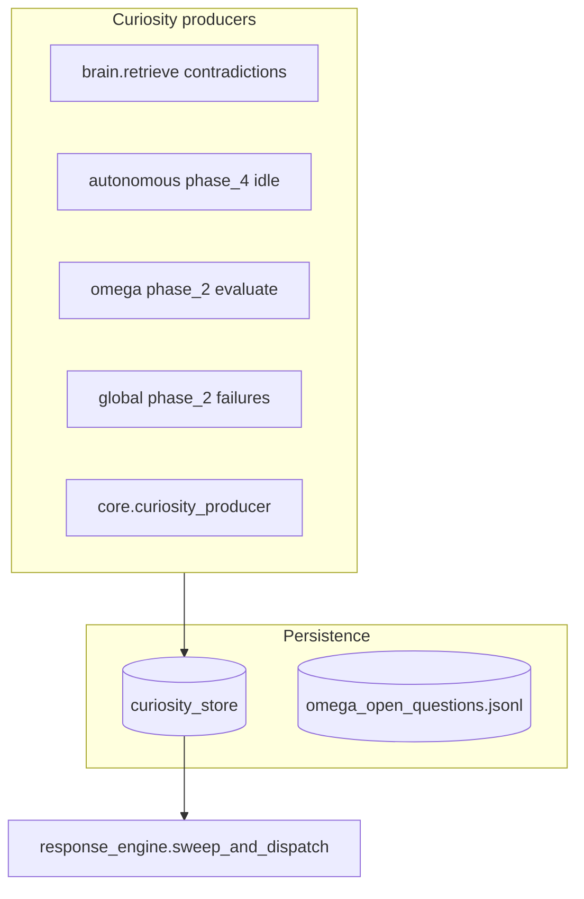
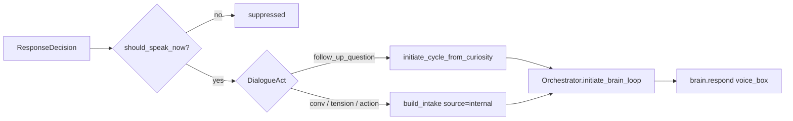
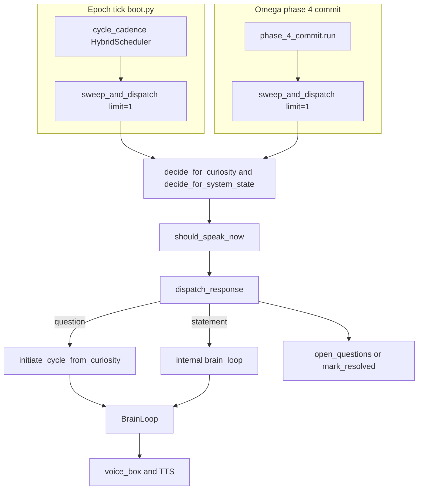
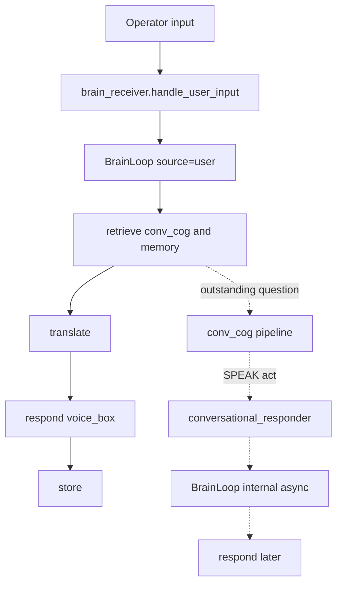

# Response System — Architecture Map

**Status**: historical architecture map. It is not the live response contract;
the current owners are `cognition_chain.py`, `auto_loop/execute/run.py`,
`organ/promptorgan/`, and the brokered `runtime.tts` / `runtime.stt` clients.

**Related contracts**:

- [`proactive_cognition.md`](proactive_cognition.md) — gap detection,
  cadence, curiosity lifecycle, and the five-wire proactive substrate.
- [`03_curiosity_development.md`](03_curiosity_development.md) — curiosity
  engine doctrine (resolution paths, gap types).
- [`01_schema_contract.md`](01_schema_contract.md) — `BrainIntake`,
  brain loop as receiver, autonomous as initiator.
- [`00_cognitive_doctrine.md`](00_cognitive_doctrine.md) — foundational cognitive principles

**Historical primary code**:

- `core/response_engine.py` — proactive act selection + dispatch
- `core/dialogue_act_selector.py` — reply-driven act selection
- `core/conversational_responder.py` — spawn internal reply cycles
- `brain/phases/_conv_cog.py` — outstanding-question closure in retrieve
- `brain/phases/respond/run.py` — voice_box delivery

---

## Executive summary

The response system is **not one module**. It is **three decision
surfaces** that converge on **one mouth** (brain `respond` → `voice_box`
→ optional TTS):

| Surface | When it runs | Primary module | Typical outcome |
|--------|----------------|----------------|-----------------|
| **Reactive (reply-driven)** | Operator just sent a message | `brain/phases/_conv_cog.py` + `core/dialogue_act_selector.py` | Ack, spawn internal reply cycle, or silent encode |
| **Proactive (system-initiated)** | Epoch cadence or omega cycle end | `core/response_engine.py` | Question, tension, observation, or action proposal |
| **Direct intake** | HUD / CLI / voice / boot signal | `core/brain_receiver.py` | User, `internal`, or `autonomous` brain cycle |

**Dialogue acts** (six values in `DialogueAct`, `core/dialogue_act_selector.py`)
are the shared vocabulary:

| Act | Meaning |
|-----|---------|
| `acknowledge` | Brief audible ack; no full reply cycle |
| `follow_up_question` | System asks the operator (often autonomous brain cycle) |
| `conversational_response` | Substantive statement |
| `tension_response` | Surface conflict, drift, or sustained pressure |
| `action_proposal` | Suggest a concrete next step |
| `silent_encode` | Write memory quietly; no speech |

**Proactive speech gates** (`core/response_engine.should_speak_now`):

- `omega_lock` held → suppress (fail-closed on lock read errors)
- Orchestrator **autonomy pause** (dev pill / agent engagement) → suppress
- Per-act cooldown: **30s**
- Per-curiosity cooldown: **90s**
- Talkativity cap: **3** dispatches per **60s** window

---

## Layer 1 — Signal producers

What creates “something to say”:



**Curiosity entries** (`CuriosityEngineEntry`, `core/schema/curiosity_engine.py`)
carry `trigger_source`, `gap_type`, `problem_statement`,
`recommended_path` (`ask_user`, `tool_creation`, `defer`, …), and status:
`open` → `active` → `resolved` / `escalated` / `deferred`.

**Store location** (`core/curiosity_store.py`):

`memory/000_identity/omega/open_questions/<curiosity_id>.json`

**Producers** (`core/curiosity_producer.py`) include memory gaps from brain
retrieve, contradictions, omega anomalies, repeated failure patterns, idle
reflection after consecutive silent auto cycles, and related hooks.

**Not spoken by response engine:** `recommended_path=tool_creation` is
handled in Omega phase 4 tool synthesis
(`metacognition/omega/phases/phase_4_commit/run.py`), not
`sweep_and_dispatch`.

---

## Layer 2 — Response engine (proactive)

### Entry points

1. **Cadence tick** — `boot.py` `run_continuous()` →
   `cycle_cadence.HybridScheduler.tick()` → when `should_initiate`, calls
   `response_engine.sweep_and_dispatch(limit=1)`. Falls back to
   `autonomous_engine.sweep_and_initiate` if import fails.
2. **Omega cycle end** — `metacognition/omega/phases/phase_4_commit/run.py`
   `_dispatch_response_at_cycle_end()` after policy commit so fresh anomaly
   curiosities can be voiced without waiting for the next cadence interval.

### Decision pipeline (`sweep_and_dispatch`)

1. Scan `curiosity_store.list_open()` → `decide_for_curiosity(entry)` using
   `_TRIGGER_GAP_TO_ACT` (examples: `memory_gap`+`knowledge` →
   `FOLLOW_UP_QUESTION`; `contradiction`+`knowledge` → `TENSION_RESPONSE`;
   `repeated_failure`+`capability` → `ACTION_PROPOSAL`).
2. `assemble_state_signals()` → `decide_for_system_state()` (chronic stress
   ≥0.7, mastery milestone, ≥3 aged open curiosities, identity drift ≥
   threshold, trajectory intensity ≥0.6 in a domain).
3. Sort `ResponseDecision` by `urgency` descending.
4. For each candidate: `should_speak_now()` → `dispatch_response()`.

### Dispatch routing



**`FOLLOW_UP_QUESTION`:**

- `curiosity_store.mark_active`
- `BrainIntake(source="autonomous", response_kind="follow_up_question")`
- Full brain loop
- On success: `open_questions.record_open_question` so the **next user
  reply** attaches to that question (`guardian/state/omega_open_questions.jsonl`)

**Statement acts** (`CONVERSATIONAL_RESPONSE`, `TENSION_RESPONSE`,
`ACTION_PROPOSAL`):

- `BrainIntake(source="internal")` with act-specific memory query / lobe hints
- On success: `curiosity_store.mark_resolved` (statement is complete when
  spoken — avoids re-dispatch “rumination” loops)

**Seed templates** (`_SEED_TEMPLATES` in `response_engine.py`) are intent
strings; `brain/phases/respond/prompt_builder.py` shapes them per
`response_kind` for voice_box.

---

## Layer 3 — Reactive reply path

Operator text → `brain_receiver.handle_user_input` →
`Orchestrator.initiate_brain_loop(source="user")`.

Inside **brain.retrieve** (`_conv_cog.consume_pending_user_reply`):

1. If open-questions journal / outstanding question matches → treat input
   as answer to prior proactive question.
2. Pipeline: `reply_evaluator.evaluate_reply` → knowledge encoder →
   `select_dialogue_act` → `affect_dispatcher` → branch:
   - `ACKNOWLEDGE` / `SILENT_ENCODE` → resolve curiosity; brief ack
   - `FOLLOW_UP_QUESTION` → refined follow-up spawner
   - `CONVERSATIONAL_RESPONSE` / `TENSION_RESPONSE` / `ACTION_PROPOSAL` →
     `conversational_responder.spawn_response_cycle` (async thread pool) →
     internal brain cycle with `response_seed`

**brain.translate** reads `conv_cog_outcome`: when a speak act spawned an
internal cycle, the **user-facing cycle** emits a **short ack** only so two
full replies do not collide (`core/conversational_responder.py`).

```mermaid
sequenceDiagram
  participant User
  participant BR as brain_receiver
  participant Loop as BrainLoop_user
  participant Conv as _conv_cog
  participant Sel as dialogue_act_selector
  participant CR as conversational_responder
  participant Int as BrainLoop_internal
  participant VB as voice_box

  User->>BR: handle_user_input
  BR->>Loop: initiate_brain_loop
  Loop->>Conv: consume_pending_user_reply
  Conv->>Sel: select_dialogue_act
  alt SPEAK_act
    Sel->>CR: spawn_response_cycle_async
    CR->>Int: initiate_brain_loop internal
    Int->>VB: respond plus TTS
    Loop->>Loop: translate brief ack only
  else ACK_or_SILENT
    Loop->>VB: ack or skip speech
  end
```

---

## Layer 4 — Brain loop (the mouth)

All dispatches end in the **4/5-phase brain loop** (`brain/brainloop.py`):

| Phase | Role for responses |
|-------|---------------------|
| **retrieve** | Memory recall; conv-cog; `memory_operations` proactive vs user |
| **translate** | `structured_response`; conv-cog ack override; tool results |
| **respond** | Prompts → `voice_box` → `delivery_metadata.text` |
| **store** | Persist delivered proactive text when metadata present |

**Historical respond phase** (`brain/phases/respond/run.py`):

- **omega_lock:** “Thinking…” surface without model call
- **Audible channels:** the historical `sensory.voice_io.speak` route is retired;
  live voice output is brokered through `runtime.tts`.
- **Fallback:** deterministic message if voice_box fails (never silent)

**Proactive memory** (`brain/phases/memory_operations.py`): `proactive_response`
recalls before outreach and stores delivered text from `delivery_metadata`
for internal/autonomous acts.

---

## Layer 5 — Operator surfaces

| Channel | Path |
|---------|------|
| **TTS** | `brain.respond` → `_speak_async` |
| **HUD chat** | `LAST_BRAIN_RESPONSE` / cycle results; HUD telemetry |
| **CLI** | `boot.run_continuous` via `brain_receiver` |

**Open questions journal:** `guardian/state/omega_open_questions.jsonl` bridges
proactive questions → user answers → omega evaluation.

---

## End-to-end proactive flow



---

## End-to-end reactive flow



---

## Legacy and fallback

| Path | Role |
|------|------|
| `autonomous_engine.sweep_and_initiate` | Legacy; `ask_user` only → question-shaped cycles. Boot fallback if `response_engine` import fails. |
| `cycle_cadence` | Schedules *when* to sweep; response engine adds multi-act routing. |
| `orchestrator.pause_default_autonomy` | Suppresses proactive sweeps during dev-pill / agent engagement. |

---

## Key files index

| Concern | File |
|---------|------|
| Proactive act + dispatch | `core/response_engine.py` |
| Reply-driven act selection | `core/dialogue_act_selector.py`, `config/dialogue_acts.yaml` |
| Spawn internal reply cycles | `core/conversational_responder.py` |
| Outstanding-question closure | `brain/phases/_conv_cog.py` |
| Reply quality signals | `core/reply_evaluator.py` |
| Autonomous question cycles | `core/autonomous_engine.py` |
| Intake construction | `core/brain_receiver.py` |
| Open-question journal | `core/open_questions.py` |
| Curiosity persistence | `core/curiosity_store.py` |
| Cadence scheduling | `core/cycle_cadence.py` |
| Boot integration | `boot.py` |
| Omega end-of-cycle speech | `metacognition/omega/phases/phase_4_commit/run.py` |
| Model delivery | `brain/phases/respond/run.py`, `brain/phases/respond/prompt_builder.py` |
| Proactive memory routing | `brain/phases/memory_operations.py` |
| Tests | `tests/integration/test_response_engine_e2e.py`, `tests/memory/test_response_engine_memory_route.py` |
